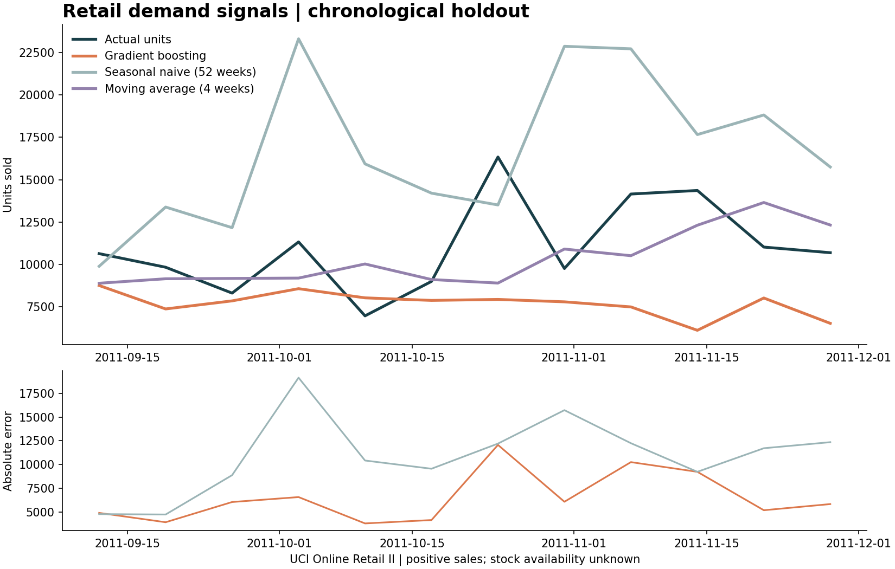

# Retail Sales Forecasting

**Weekly product sales forecasts, honest baseline comparisons, and an editable Power BI report.**

Python · pandas · NumPy · SQL · scikit-learn · Power BI · Streamlit



## What this project does

Turns the public **UCI Online Retail II** transaction workbook into weekly product sales, removes duplicate and invalid rows, separates returns, and compares histogram gradient boosting with a 52-week seasonal-naive baseline and a four-week moving average. All evaluation dates are later than training dates. A dashboard shows forecasts and error trends with store/channel and product filters.

The public data represents **one UK online retailer**, not a multi-store chain. The code supports multiple store IDs; the optional synthetic demo has two. It is not affiliated with Trent, Westside or Zudio.

## Results on the public data

Twenty products; 240 one-week-ahead predictions; holdout **12 September–28 November 2011**.

| Model | MAE, units | WAPE |
|---|---:|---:|
| Gradient boosting | 324.61 | 58.88% |
| Seasonal naive, 52 weeks | 545.48 | 98.94% |
| Moving average, 4 weeks | **289.77** | **52.56%** |

Gradient boosting improves on the annual baseline, but the moving average wins this holdout. This is a reproducible comparison, not a claim of production readiness. The high errors and systematic underforecasting deserve attention before inventory decisions.

## Open the dashboard

Python 3.11 or later is required; Python 3.12 was used for verification.

```bash
python -m venv .venv
# Windows: .venv\Scripts\activate
# macOS/Linux: source .venv/bin/activate
python -m pip install -e .
python -m streamlit run app.py
```

The repository includes actual public-data reports, so the dashboard works before downloading the raw workbook.

## Reproduce the analysis

```bash
python -m retail_forecast.cli download
python -m retail_forecast.cli run --input data/raw/online_retail_II.xlsx
```

This downloads the roughly 44 MB workbook. Reading both sheets can take a few minutes. Input checksums and cleaning counts are recorded in `reports/provenance.json`.

For a quick, clearly labelled synthetic run:

```bash
python -m retail_forecast.cli run --demo --output reports/demo
```

`--top-products` and `--test-weeks` control the evaluated cohort and holdout length. For an alternative transaction CSV, use the original UCI column names described in `data/README.md`.

## Power BI

Open **`powerbi/RetailForecast.pbip`** in Power BI Desktop and click **Refresh**. The model embeds the 240 evaluation rows in Power Query, so no absolute file path or database credentials are needed. The report includes two slicers, four KPI cards, forecast and error charts, and a product-performance table. Filters affect the DAX measures, including WAPE.

After generating new predictions:

```bash
python scripts/build_powerbi.py
python -m pip install jsonschema
python scripts/validate_powerbi.py
```

The PBIP/PBIR JSON is checked against Microsoft's published schemas. **Power BI Desktop rendering, M execution and DAX execution have not been verified in this Linux environment.** See [Power BI notes](powerbi/README.md). The Python dashboard is executable and tested here.

## Method

1. Normalize dates and IDs, drop exact duplicates, retain a separate cancellation/negative-quantity ledger, and exclude zero-price and non-merchandise records.
2. Aggregate units and revenue in [SQL](retail_forecast/weekly_sales.sql); drop incomplete extraction-edge weeks. Fill missing product-week transactions with zero, while retaining a missing-observation flag.
3. Select the top 20 products **before** the validation period. Construct lag 1/2/4/13/52, shifted rolling mean/std, calendar seasonality and product/store features.
4. Choose among three gradient-boosting configurations on the eight weeks immediately before the test window. Disable random early-stopping splits.
5. Refit on pre-test observations. Evaluate rolling one-week-ahead predictions with the model frozen. Once a test week's sales are observed, they may enter the next week's lags. This is **not** a fixed-origin 12-week forecast.
6. Refit on all available complete weeks for the separate next-week forecast export.

`MAE = mean(abs(actual − forecast))`. `WAPE = sum(abs(actual − forecast)) / sum(abs(actual))`. WAPE is undefined for an all-zero actual series, and is stored as null in that case.

## Files and checks

| Location | Purpose |
|---|---|
| `retail_forecast/` | Ingestion, SQL aggregation, chronological evaluation and CLI |
| `app.py` | Filterable Streamlit dashboard |
| `reports/` | Reproducible metrics, predictions, plot, provenance and next-week export |
| `powerbi/` | Editable report and semantic model sources |
| `tests/` | Leakage, metric, cleaning, split and forecast checks |
| `.github/workflows/ci.yml` | Unit tests and an offline synthetic smoke run |

```bash
python -m pip install -r requirements-dev.txt
python -m pytest -q
docker build -t retail-forecast .
docker run --rm -p 8501:8501 retail-forecast
```

Docker configuration is supplied; Docker image execution was not available during verification.

## Limitations and interview notes

- These are **sales**, not unconstrained demand. A stockout can create zero sales even when people want the product. The source has no inventory or availability history; no lost-sales estimate is justified.
- Missing transaction weeks and pre-launch periods are both treated as zero. This can distort lags. Only two annual cycles and 800 fitted rows remain after requiring 52-week history.
- Wholesale orders, product churn and promotion changes can produce large spikes. The model lacks promotions, price dynamics and calendar-event features.
- One store and one holdout do not establish generalization. Next work: rolling-origin folds, product-level error review, availability data and prediction intervals. Choose a baseline when it is better.

Be prepared to explain why shifted features prevent leakage, why MAE and WAPE differ, and why a complex model may lose to a moving average.

## Attribution

Daqing Chen (2012), **Online Retail II**, UCI Machine Learning Repository, [DOI 10.24432/C5CG6D](https://doi.org/10.24432/C5CG6D), licensed [CC BY 4.0](https://creativecommons.org/licenses/by/4.0/). The committed CSVs and plot are transformed aggregates from this source. Code is MIT-licensed. No raw workbook, private résumé, passwords or API keys are included.
